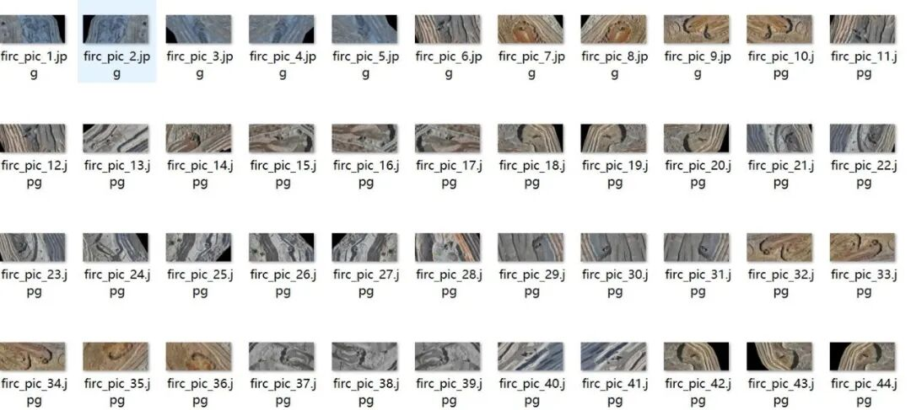
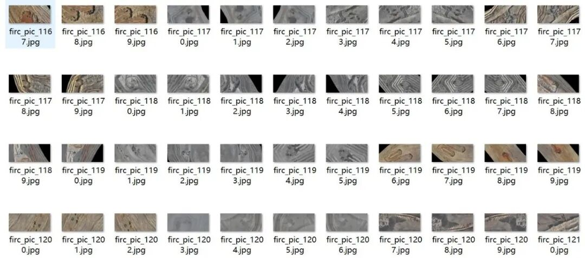
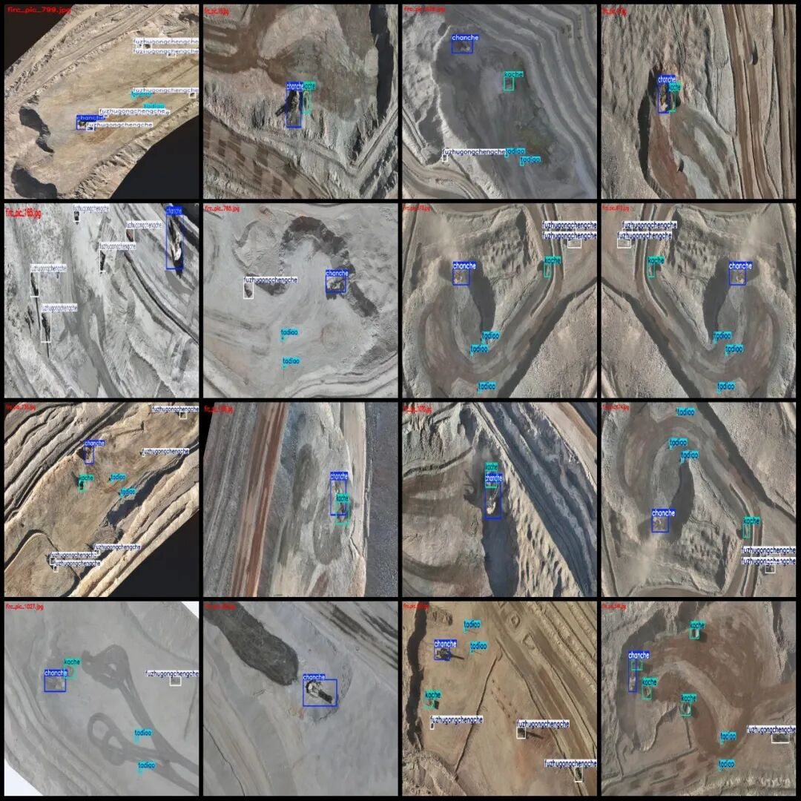
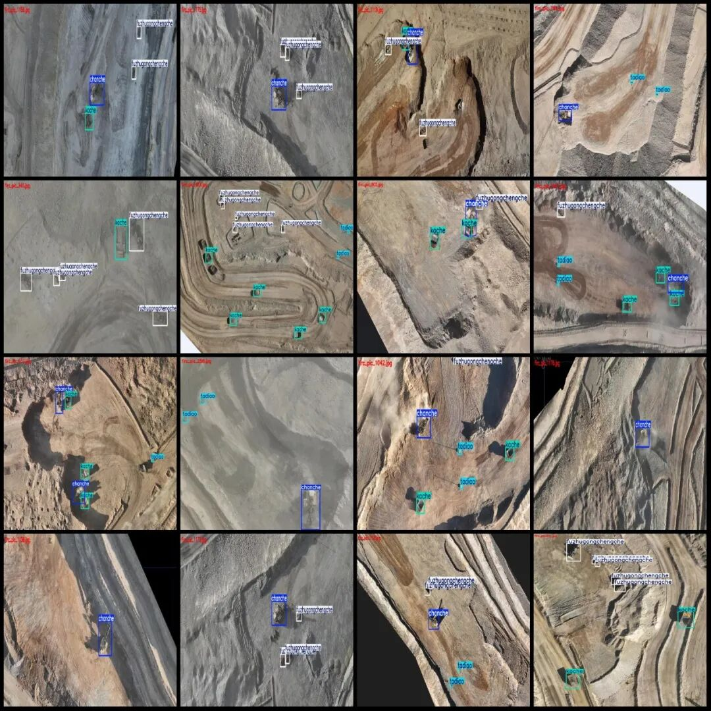

# Drone-view aerial photography dataset for mining site construction vehicles, excavators, trucks, etc. VOC+YOLO format: 1222 images in 4 categories

Please note that approximately 600 images in the dataset are original and the rest are enhanced.

Dataset format: Pascal VOC format + YOLO format (txt file without split path, only containing jpg images and corresponding VOC format xml files and yolo format txt files)

Number of images (number of jpg files): 1222

Number of annotations (number of xml files): 1222

Number of annotations (number of txt files): 1222

Labeling category count: 4

Label category names (Note that the order of categories in the YOLO format does not correspond to this, but is based on the classes.txt file in the labels folder): ["chanche", "fuzhugongchengche", "kache", "tadiao"]

Number of boxes labeled in each category:

Chanche (excavator) frame count = 1243

fuzhugongchengche (auxiliary engineering vehicle) frame count = 1713

Kache (truck/dump truck) Frames = 2124

tadiao (Tadao) frame count = 1813

Total frame count: 6893

Number of images per category:

Chanche's possession of images = 1107

fuzhugongchengche occupies = 712

Kache's number of images = 863

tadiao occupies the number of images = 767

Image resolution: Multi-resolution images, such as 1334x918, 2048x929, etc.

Using labelImg:

Annotation rules: Draw a rectangle around the category.

Important Notice: The dataset does not have separate training, validation, and test sets; you need to partition them yourself.

Special : This dataset does not guarantee the accuracy of the trained models or weight files.

Image Preview:

Annotation example:

## Payment

Here is a pay link on Stripe ( https://buy.stripe.com/3cs8yP7sY87d0vu9AB ). Please contact me lonlonago@foxmail.com after funding $89, and I will send you a complete data files , thank you!

